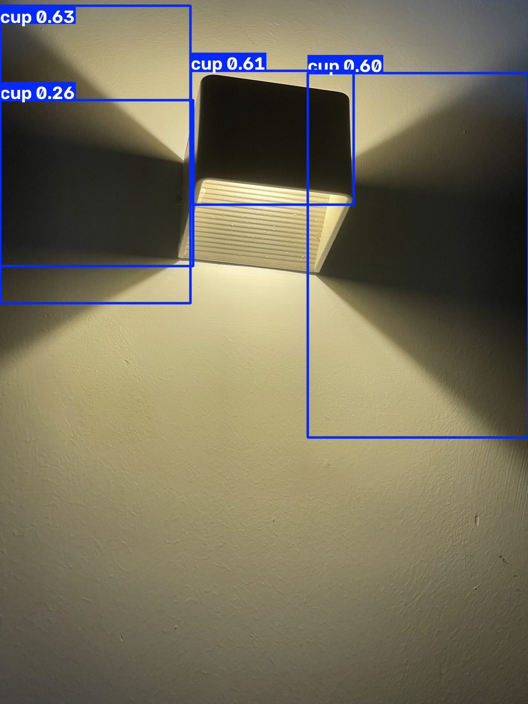
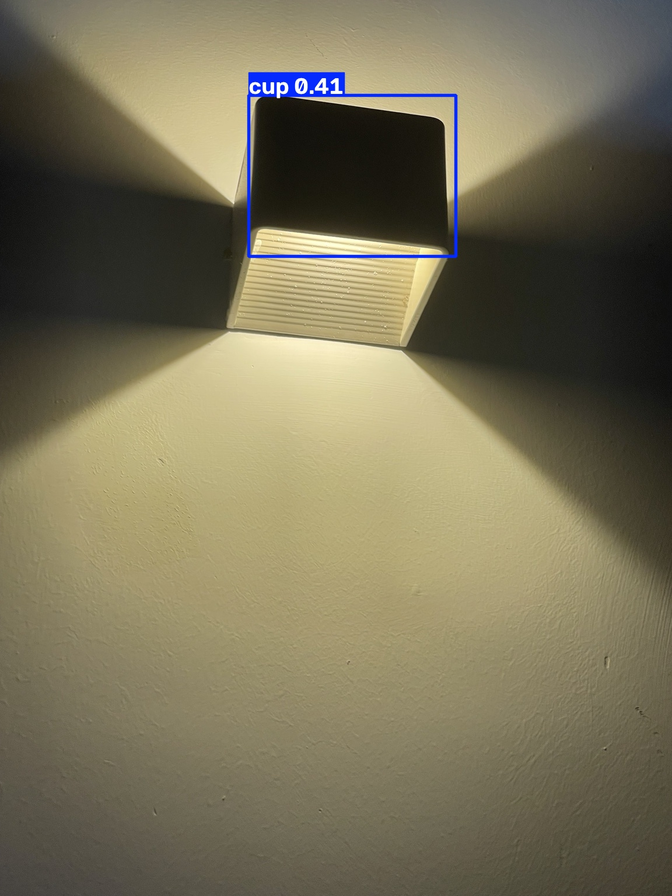
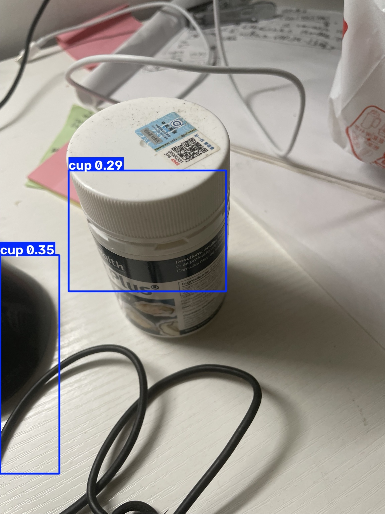
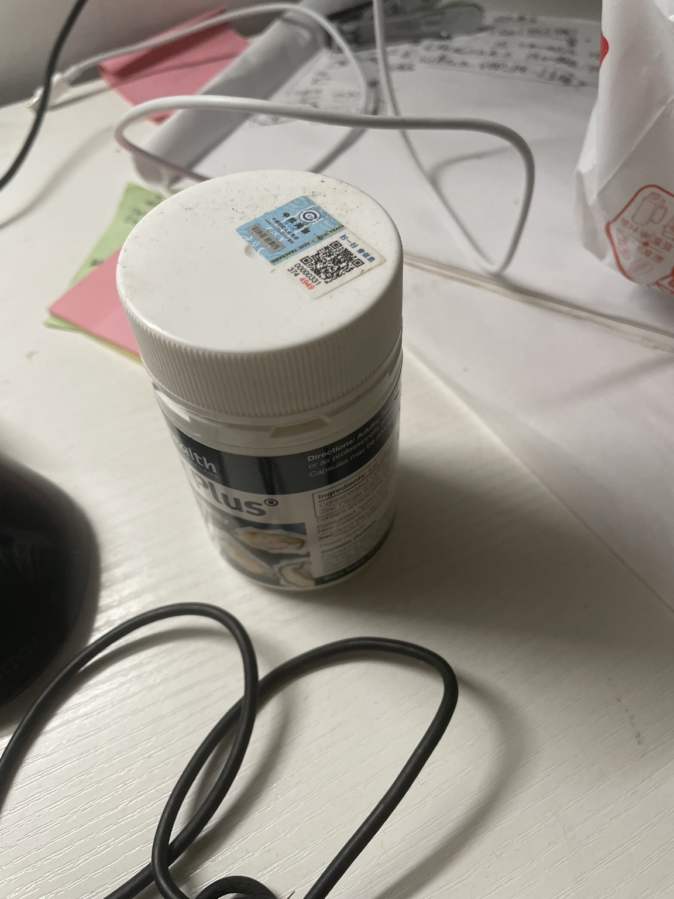
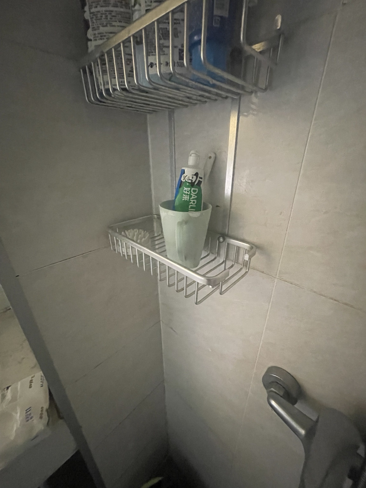

# Cup Detection Data Flywheel

一个围绕 Cup Object Detection 构建的最小数据飞轮项目。

项目目标不是单纯训练一个 YOLO 模型，而是完整实践：

数据质量检查 → 清洗 → 标注 → Dataset Construction → Leakage Check → Baseline Training → Challenge Set → Failure Analysis → Targeted Data Collection → Retraining → Re-evaluation

---

## 1. Project Goal

构建一个可复现的小型 Object Detection 数据闭环，理解真实 AI 数据工程中：

- 如何判断原始数据是否可用
- 如何发现重复、错误和潜在数据泄漏
- 如何制定标注规则并进行 Annotation QC
- 如何建立 Train / Val / Test
- 如何建立 Baseline
- 如何通过 Challenge Set 主动发现模型弱点
- 如何根据 Failure Mode 有针对性地补数据
- 如何验证补数据是否真正改善模型

Task:

```text
Cup Object Detection
Class: cup
Model: YOLOv8n
2. Data Pipeline
Raw Data
↓
Technical QC
↓
Deduplication
↓
Semantic Review
↓
Annotation Guideline
↓
Pilot Annotation
↓
Pre-label QC
↓
Human Correction
↓
Final Ground Truth
↓
Dataset Construction
↓
Train / Val / Test
↓
Leakage Check
↓
Baseline V1
↓
Standard Evaluation
↓
Challenge Set
↓
Failure Analysis
↓
Targeted Data Collection
↓
Dataset V2
↓
Retraining
↓
Re-evaluation
↓
New Data Gap
3. Raw Data & Quality Control

Original dataset:

141 images
640 × 480
.jpg

Technical QC results:

Readable images: 141
Corrupted images: 0
Exact duplicate images: 20

After deduplication:

141 → 121 images

原则：

Raw Data 保持不变，清洗后的数据写入新的目录，并保留 QC Report 和处理日志。

4. Semantic Review

对去重后的 121 张图片进行语义审核：

Positive: 119
Review: 2
Negative: 0
Reject: 0

最终保留：

121 usable images

核心认识：

Technical Validity 不等于 Semantic Usefulness。

困难样本并不等于坏样本。遮挡、暗光、特殊视角只要仍然可识别、可标注，就可以作为有效数据。

5. Annotation & QC

Annotation task:

Class: cup
Bounding Box: horizontal rectangle

Annotation rules:

一只杯子对应一个 bbox
多个杯子分别标注
尽量包含完整目标
尽量减少背景
不切掉目标主体
倾斜目标仍使用水平框
保持标注标准一致

核心原则：

Correct
+
Complete
+
Consistent

Pre-label QC 抽检 20 张：

Accept: 8
Minor Fix: 12
Major Fix: 0

说明原始预标注存在较明显的 bbox looseness，因此采用：

Existing Labels
→ Pre-label
→ Human Correction
→ Final Ground Truth

而不是直接把已有标签视为 Ground Truth。

6. Dataset V1

Dataset V1:

Train: 96
Val: 12
Test: 13

Leakage Check:

Exact Duplicate Leakage: PASS
Near Duplicate Leakage: PASS

Exact duplicate 使用 Hash 检查。

Near duplicate 使用 perceptual hash 进行候选筛查。

对于机器人、视频和轨迹数据，原则进一步升级为：

不应随机拆 Frame，优先按 Episode / Scene / Trajectory 进行数据划分。

7. Baseline V1

Model:

YOLOv8n
Pretrained weights
Epochs: 30
Image size: 416
Batch size: 4
Device: CPU

V1 Test:

Metric	Result
Precision	0.995
Recall	1.000
mAP50	0.995
mAP50-95	0.896

Standard Test Set 表现非常高。

但 Test Set 与 Train 数据分布较接近，因此进一步构建真实手机拍摄 Challenge Set。

8. Challenge Set

Challenge Set 共 24 张真实手机图片，覆盖：

Real-world domain shift
Negative samples
Hard negative objects
Small / distant cup
Occlusion
Partial crop
Complex background
Different viewpoints

V1 在 Challenge Set 上暴露明显问题：

False Positive

典型误报：

灯具
药瓶
水桶
插座
其他容器类物体
False Negative

典型漏检：

远距离杯子
小尺度杯子
新环境中的杯子

说明：

高同分布 Test Performance 不代表真实场景鲁棒性。

9. Failure Analysis

V1 主要 Data Gap：

1. Negative Samples 不足
2. Hard Negative 不足
3. Small / Distant Cup 不足
4. Real-world Hard Positive 多样性不足

因此 Dataset V2 不进行随机扩充，而采用 Targeted Data Collection。

10. Dataset V2

新增 32 张 targeted samples：

8 Pure Negative
8 Hard Negative
8 Small / Distant Positive
8 Hard Positive

其中：

16 Negative / Hard Negative
→ empty YOLO labels

16 Positive samples
→ cup bbox labels

Dataset V2:

Train: 128
Val: 12
Test: 13

Val / Test 保持与 V1 完全一致。

训练参数也保持一致。

唯一主要变量：

Training Data
11. V1 vs V2 Standard Evaluation
Metric	V1	V2
Train Images	96	128
Val Precision	0.998	0.998
Val Recall	1.000	1.000
Val mAP50	0.995	0.995
Val mAP50-95	0.886	0.875
Test Precision	0.995	0.996
Test Recall	1.000	1.000
Test mAP50	0.995	0.995
Test mAP50-95	0.896	0.910

V2 没有明显破坏原有标准测试性能。

12. Challenge Set: V1 vs V2

图片级人工 Failure Analysis:

Metric	V1	V2
Positive-image Detection Rate	~90%	~60%
Negative-image False Positive Rate	~42.9%	~14.3%
Total Predicted Boxes	39	9

注意：

以上为 Challenge Set 图片级人工分析，不是正式 Object Detection mAP。

## Visual Failure Analysis: V1 vs V2

除了标准 Val / Test 指标外，我使用同一组真实手机拍摄的 Challenge Set 对 V1 和 V2 进行定性对比。

### Case 1: Lamp False Positive

| V1 | V2 |
| --- | --- |
|  |  |
| 4 cup detections | 1 cup detection |

V1 将灯具多个区域错误识别为 cup。

在 Dataset V2 加入 Negative / Hard Negative 后，误报数量明显下降，但仍残留 1 个 False Positive。

**Finding:** Hard Negative supplementation 有效，但该 Failure Mode 尚未完全解决。

---

### Case 2: Bottle / Container False Positive

| V1 | V2 |
| --- | --- |
|  |  |
| 2 false cup detections | No detection |

V1 将非 cup 的圆柱形容器识别为 cup。

V2 不再产生检测结果。

**Finding:** 针对瓶、罐等相似容器增加 Hard Negative 后，类别边界得到明显改善。

---

### Case 3: Distant Cup False Negative

| V1 | V2 |
| --- | --- |
|  |  |
| No detection | No detection |

真实 cup 位于较远位置，占图像比例较小。

V1 和 V2 均未检测到该目标。

**Finding:** Dataset V2 虽然降低了 False Positive，但 Small / Distant Cup 的 Recall 问题仍未解决。

---

### Visual Analysis Conclusion

Challenge Set 显示：

- V2 对非 cup 物体的 False Positive 明显减少
- Hard Negative supplementation 被证明有效
- Small / Distant Cup 仍存在 False Negative
- 下一轮数据策略应减少继续增加 Negative，转向 Diverse Hard Positive

因此下一轮的核心目标应为：

> 保持较低 False Positive，同时提高真实困难场景下的 Recall。

13. Key Finding

V2 的 Negative / Hard Negative supplementation 明显有效：

False Positive ↓

模型减少了对药瓶、插座、瓶罐等非 cup 物体的误识别。

但新的问题出现：

False Negative ↑

模型变得更加保守。

部分远距离、裁切、复杂背景和新场景中的真实 cup 出现漏检。

因此产生明显的 Precision / Recall Trade-off。

14. New Data Gap

V2 暴露出的主要问题不再是 Negative 不足，而是：

Diverse Hard Positive 不足

当前 Hard Positive 仍存在：

cup 类型较单一
同一绿色马克杯占比较高
场景多样性有限
材质、颜色、形状覆盖不足
Extreme small object 覆盖不足

下一轮 Dataset V3 应优先补：

Different cup types
Different colors
Different materials
Kitchen / bathroom / office
Small & distant cups
Partial crop
Occlusion
Low light
Complex background
Cup containing other objects

目标：

保持较低 False Positive
+
恢复 Hard Case Recall
15. Core Lesson

这个项目最重要的结果不是得到一个高 mAP 模型。

真正的学习是：

Offline Benchmark 很高，并不代表模型能够应对真实世界的 Distribution Shift。

以及：

数据补充不应该只是增加数量，而应该从模型 Failure 出发，根据 Failure Mode 定位 Data Gap，再进行 Targeted Data Collection。

完整闭环：

Model Failure
↓
Failure Attribution
↓
Data Gap
↓
Targeted Collection
↓
Retraining
↓
Re-evaluation
↓
New Failure

这就是一个最小 Data Flywheel。

16. Project Structure
cup_dataset_project
├── data
│   ├── raw
│   ├── cleaned
│   ├── challenge_set
│   └── v2_supplement
├── dataset_v1
├── dataset_v2
├── final_export
├── prelabel_source
├── reports
├── notes
├── scripts
├── models
├── runs
└── assets
17. Reports

Key reports:

reports/data_quality_report.csv
reports/duplicate_report.csv
reports/semantic_review.csv
reports/prelabel_qc.csv
reports/leakage_report.csv
reports/v1_v2_failure_analysis.md
18. Summary

This project implements a small but complete object-detection data flywheel:

Data Quality
→ Ground Truth
→ Dataset
→ Training
→ Evaluation
→ Failure Analysis
→ Targeted Data
→ Retraining
→ Re-evaluation

The key conclusion is that model performance should not only be evaluated by a single benchmark metric.

Real robustness comes from continuously discovering failure modes and converting those failures into better data.